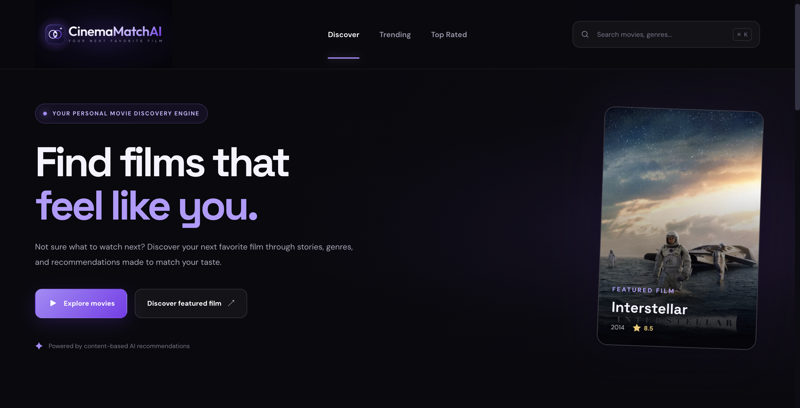
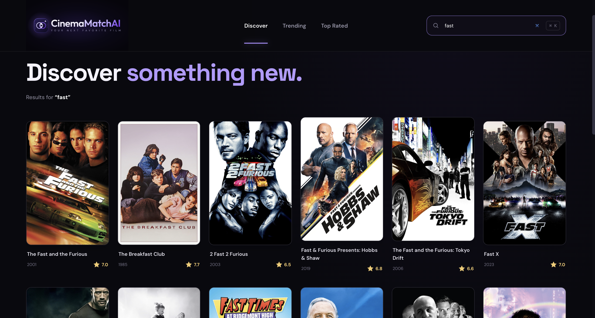
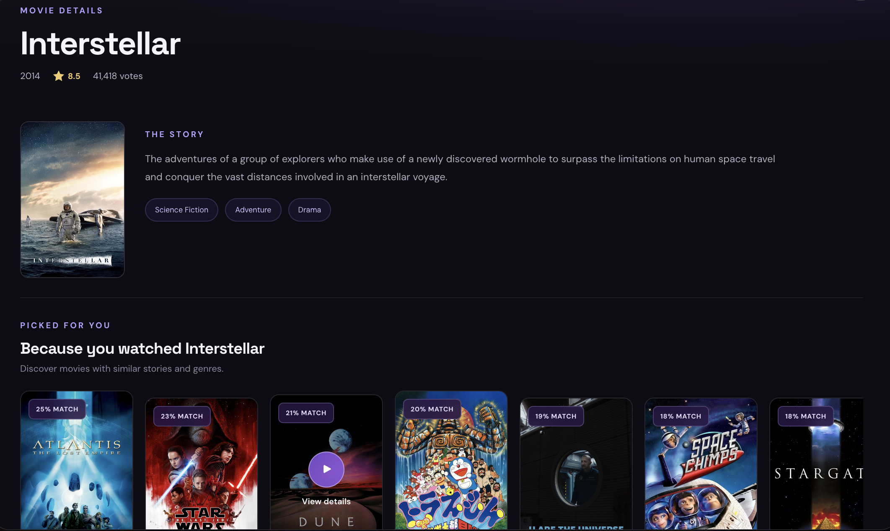
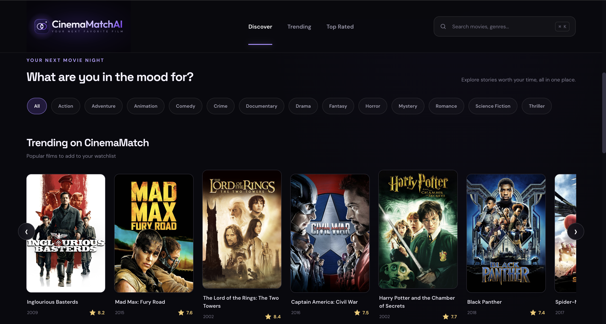
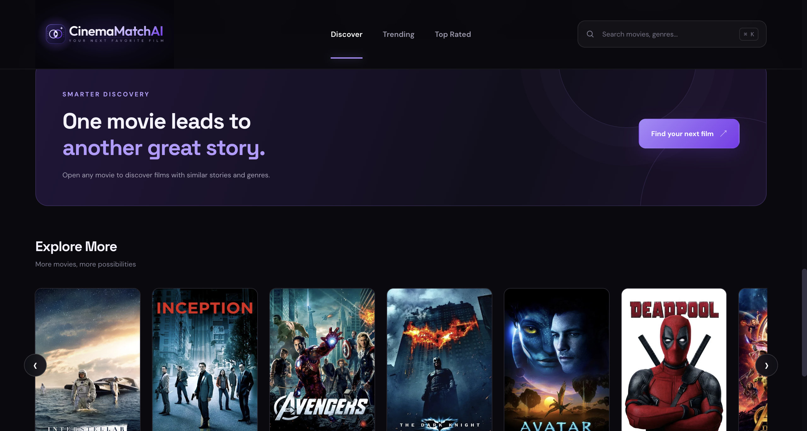

# 🎬 CinemaMatch AI

### Discover your next favorite movie with intelligent recommendations.

CinemaMatch AI is a full-stack movie recommendation application that helps users discover movies based on content similarity. It combines a machine-learning recommendation engine with a modern React interface and a FastAPI backend to deliver an interactive movie discovery experience.

🌐 **Live Demo:** https://cinema-match-ai.vercel.app

---

## ✨ Features

- 🎥 **Movie Discovery:** Explore a catalogue of movies.
- 🔍 **Movie Search:** Find movies using the available search functionality.
- 🧠 **Intelligent Recommendations:** Discover similar movies using content-based recommendation techniques.
- ⭐ **Top-Rated Movies:** Explore highly rated movies.
- 🖼️ **Movie Posters:** Browse movies through a visual interface.
- ⚡ **FastAPI Backend:** Serve movie data and recommendations through API endpoints.
- 📱 **Modern Frontend:** Interactive React interface built with Vite.
- ☁️ **Cloud Deployment:** Frontend hosted on Vercel and backend hosted on Render.

---

## 🧠 Machine Learning Approach

CinemaMatch AI uses content-based movie recommendation techniques.

The recommendation system analyzes movie information and calculates similarities to identify movies related to a selected title.

The project includes multiple similarity components, including:

- Title similarity
- Story similarity
- Genre similarity

These components contribute to the recommendation process implemented by the project's recommendation engine.

The backend loads the movie catalogue and recommendation components during application startup, allowing the system to serve recommendations through API requests.

---

## 🏗️ System Architecture

```text
                  USER
                    |
                    v
          React + Vite Frontend
                 (Vercel)
                    |
                    | HTTP API Requests
                    v
             FastAPI Backend
                (Render)
                    |
                    v
          Movie Recommendation Engine
                    |
          +---------+---------+
          |         |         |
          v         v         v
        Title     Story     Genre
      Similarity Similarity Similarity
          |         |         |
          +---------+---------+
                    |
                    v
          Recommended Movies
                    |
                    v
              USER INTERFACE
```

---

## 🛠️ Technology Stack

| Component | Technologies |
|---|---|
| Programming Language | Python |
| Backend | FastAPI, Uvicorn |
| Data Processing | pandas, NumPy |
| Machine Learning | scikit-learn |
| Model Utilities | joblib |
| Frontend | React, JavaScript |
| Frontend Build Tool | Vite |
| Backend Hosting | Render |
| Frontend Hosting | Vercel |
| Version Control | Git, GitHub |

---

## 📁 Project Structure

```text
CinemaMatchAI/
│
├── backend/
│   └── main.py
│
├── frontend/
│   ├── public/
│   │   └── images/
│   │       └── cinematch-logo.png
│   ├── src/
│   ├── package.json
│   └── ...
│
├── data/
│   └── processed/
│       └── catalog_cleaned.csv
│
├── models/
│   ├── tfidf_matrix.joblib
│   └── movie_metadata.joblib
│
├── src/
│
├── requirements.txt
├── render.yaml
├── .gitignore
└── README.md
```

---

## 🚀 Run Locally

### Prerequisites

Install the following:

- Python 3.13 or a compatible Python version
- Node.js and npm
- Git

### 1. Clone the repository

```bash
git clone https://github.com/KANADMALPE10/CinemaMatchAI.git

cd CinemaMatchAI
```

### 2. Set up the Python environment

```bash
python -m venv .venv
```

Activate the environment.

**macOS / Linux:**

```bash
source .venv/bin/activate
```

**Windows PowerShell:**

```powershell
.venv\Scripts\Activate.ps1
```

### 3. Install backend dependencies

```bash
pip install -r requirements.txt
```

### 4. Start the backend

From the project root, run:

```bash
python -m uvicorn backend.main:app --reload
```

The API should be available at:

http://127.0.0.1:8000

Interactive API documentation:

http://127.0.0.1:8000/docs

### 5. Configure the frontend

Open a second terminal and navigate to the frontend directory:

```bash
cd frontend
```

Install dependencies:

```bash
npm install
```

Create a `.env` file inside `frontend/` containing:

```env
VITE_API_BASE_URL=http://127.0.0.1:8000
```

### 6. Start the frontend

```bash
npm run dev
```

Open the local URL printed by Vite, normally:

http://localhost:5173

---

## ☁️ Deployment

CinemaMatch AI is deployed using separate frontend and backend services.

| Service | Platform |
|---|---|
| Frontend | Vercel |
| Backend API | Render |

### Live Application

https://cinema-match-ai.vercel.app

### Backend API

https://cinemamatchai.onrender.com

### Interactive API Documentation

https://cinemamatchai.onrender.com/docs

---

## 🔮 Future Improvements

Potential improvements include:

- Personalized recommendations based on user preferences.
- Recommendation explanations.
- User ratings and feedback.
- Improved recommendation evaluation metrics.
- Automated testing for the API and recommendation engine.
- Performance monitoring and caching.
- Enhanced mobile experience.

---

## 👨‍💻 Author

**Kanad Malpe**

Electronics and Telecommunication Engineering student interested in Machine Learning, Data Science, and AI Engineering.

### Project Links

- 🌐 Live Application: https://cinema-match-ai.vercel.app
- 💻 GitHub Repository: https://github.com/KANADMALPE10/CinemaMatchAI

---

*CinemaMatch AI — Find your next favorite film.*

## 📸 Application Screenshots

### Homepage



### Movie Search



### Movie Recommendations



### Additional Recommendations


### Trending Movies



### Top-Rated Movies


### Explore More

